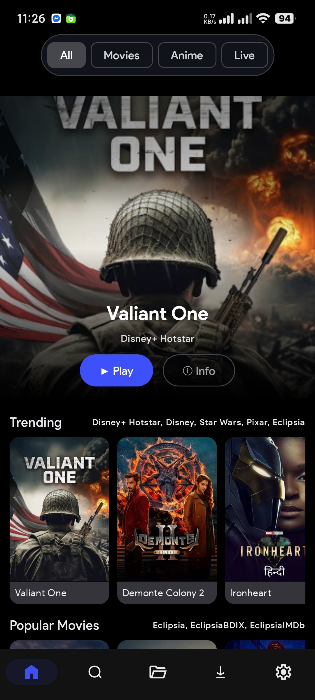
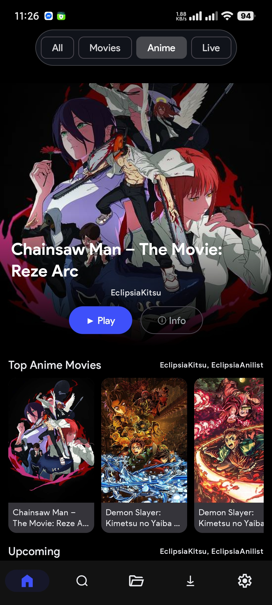
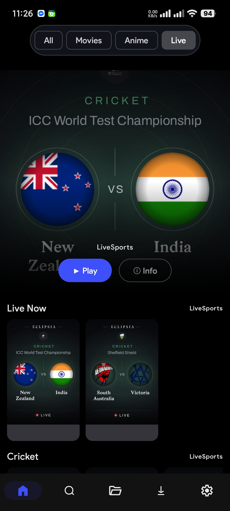

# SoraCast

SoraCast is an Android media app with a clean dark interface, quick category switching across movies, anime, and live broadcasts, a custom app identity, and built-in GitHub release updates.

## Screenshots

| Home & Movies | Anime | Live Sports |
| :---: | :---: | :---: |
|  |  |  |

## What Changed

- **Custom App Identity:** Updated the app icon and splash screen with SoraCast branding and a deep navy backdrop (`#242855`).
- **Cleaner Layout & Spacing:** Refined the top category bar (`All`, `Movies`, `Anime`, `Live`) and spacing across sections so featured posters, titles, and action buttons sit cleanly without crowding or overlap.
- **Smoother Details & Downloads:** Fixed a crash that occurred when opening content detail pages so you can view details and start downloads reliably.
- **Easy Updates:** Connected the app updater to the `SoraCast-` GitHub repository so new releases can be checked and downloaded directly.

## Installation

1. Go to the [Releases](https://github.com/robbisardar39-jpg/SoraCast-/releases) page and download `SoraCast-release-signed.apk`.
2. Allow installing apps from your browser or file manager if Android asks.
3. Install and open SoraCast.
